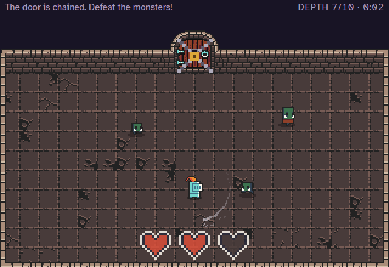

# Who Wants To Be A Dungeon Crawler

A pixel-art dungeon crawler that runs in the browser, built as a timed incremental game. Runs are short: the clock starts at 15 seconds and you have one heart. Monsters rise from the floor of every room, every kill fills the room's XP bar, and a full bar unchains the door deeper. Ten rooms down, a boss waits.



**[▶ Play it in your browser](https://dungeon-crawler.salihonder.dev)**

## How to play

| Key | Action |
|---|---|
| <kbd>W</kbd> <kbd>A</kbd> <kbd>S</kbd> <kbd>D</kbd> or arrow keys | Move (the hero swings on their own, the way they're facing) |
| <kbd>E</kbd> | Open a door, pull a lever, climb a ladder, use the altar, pick a hero, visit a credit's link |
| <kbd>Shift</kbd> | Dash, once it's unlocked |

The menu is a room too: walk through **PLAY** to start, or explore **HEROES**, **OPTIONS** and **CREDITS**. In the dungeon, the hero swings automatically whenever there's a monster up, so you only move: face the monsters to hit them, and keep away from them. Monsters rise as you land, more keep coming, and every kill fills the XP bar at the top of the room. When it's full, the door unchains and you drop into the next room. The clock at the top left only runs while you're in control. When it reaches 0, or a monster gets you, the run is over: little hands reach up out of the floor and drag you down to the underworld, where the run's results are written on the floor. Gold you pick up is banked, and the altar in the middle of the underworld spends it on the skill tree. After the first visit, a well in the title room leads straight down to it.

In the tenth room, once its bar is full, the clock stops and the Big Zombie makes its entrance: the room shakes, the monsters still up crumble into coins, and it rises in the middle of the room and roars. Beat it, and it bursts into a pile of coins and leaves a well down to the underworld and a ladder up to the menu.

The skill tree works with the mouse or the keyboard. Point at a node to read it, click it to pick it and click it again to buy a level; hold the button and drag to look around, and use the wheel to zoom. With the keyboard, the arrow keys or <kbd>W</kbd> <kbd>A</kbd> <kbd>S</kbd> <kbd>D</kbd> move between nodes, <kbd>E</kbd> buys, <kbd>+</kbd> and <kbd>-</kbd> zoom, and <kbd>Esc</kbd> closes it.

The game needs a keyboard. On phones and tablets, a notice says so.

## Features

- **Rooms that fill an XP bar:** monsters rise as you land, a horde arrives every 20 seconds whether or not the room is clear, and when the last monster falls, another rises at once. Every kill fills the room's bar, split in two halves on either side of the door, and a full bar unchains it. The monsters still up stay, for their gold, if you want it.
- **A clock that ends the run:** 15 seconds at the start, counting down only while you're in control, red and ticking for the last five. Each hit costs a whole heart, and you start with one.
- **The crypt's monsters:** tiny zombies chase you, skeletons rattle as a warning and then charge in a straight line, and slugs split into two tiny slugs when they fall. Deeper rooms bring more of them, with more health. Every hit's damage pops up as a number, and a tiny hit-stop makes it land with weight.
- **Gold on the floor:** kills drop coins, and a small magnet pulls in the ones you get close to. Coins left behind when you go through the door are lost; when a run ends, the ones still on the floor fly to you from all over the room as you're dragged down.
- **The underworld:** every run ends there, dragged down by the hands, with the results on the floor (how it ended, the gold earned and banked, how deep it got, the kills), an altar in the middle and ladders to try again or return to the menu. The altar's sigil glows when there's something you can afford.
- **A skill tree at the altar:** a web of 24 nodes drawn over the room, growing out of Descend in the middle into six branches: weapon, hearts, time, dash, money and the horde. Each node is a round frame with an icon (from the tileset, or a few hand-drawn pixels) and, for nodes with more than one level, a pip per level. You see the nodes next to the ones you own; the ones further out are dark outlines. Depth-2 nodes can be bought early, at three times the price. The panel at the bottom shows what the next level does ("DAMAGE 1 > 2", or "MAGNET RANGE +25%") and what it costs.
- **Saved progress:** banked gold and bought upgrades are saved in the browser after every run and every purchase. The Options room has a red reset button that asks twice before it erases them.
- **Hearts to win back:** with more than one heart, monsters can drop a heart while you're missing one. A bad-luck counter makes sure the drops don't dry up, and a dropped heart blinks out after a few seconds.
- **A boss fight that keeps you moving:** the Big Zombie makes its entrance in the last room once its bar is full, and the clock stops for it. It casts a random move every couple of seconds, each with its own warning flash: a dash that leaves a trail of fire, a ring of 12 projectiles, or raising tiny zombies. Once the projectiles turn yellow, a swing bats them back at it. Below half health it becomes enraged: it dashes twice and fires a second ring that covers the gaps in the first.
- **10 playable heroes, each with their own weapon:** pick one in the Heroes room, and it's remembered.
- **A volume mixer you walk around in:** sound effects and music each have a slider on the floor, a stone block you bump along a rail from 0 to 10, one notch per bump, so you can set your own mix of effects and music. Screen shake is a lever. All of it is remembered between visits.
- **Sound and music made in code:** sound effects are generated with ZzFX, and the background music is a chiptune loop composed in code with the Web Audio API. There are no audio files.

## How it works

Plain JavaScript (ES modules) with the [Kaplay](https://kaplayjs.com) game engine. There's no build step: the browser loads `index.html` and the files in `src/` directly, and GitHub Pages hosts it.

A few parts worth a look:

- **One interaction system** ([`src/interact.js`](src/interact.js)): doors, levers, heroes, ladders, plaques, the altar and the well all work the same way. Each is a zone, a prompt and a `use()` function, and one small module handles detecting the nearest one, the on-screen prompt and the key presses.
- **Cutscenes with `async`/`await`** ([`src/cutscenes.js`](src/cutscenes.js)): Kaplay's tweens and timers are wrapped in Promises, so sequences like "open the door, walk in, fade out" read top to bottom.
- **Layered drawing:** when the knight steps into a doorway, he's drawn behind the door frame but in front of the darkness behind it, using draw order (`z`), so he really walks *into* the door.
- **Crisp pixels** ([`src/display.js`](src/display.js)): the game is drawn at 320×208 and scaled up by a whole number of real screen pixels (accounting for `devicePixelRatio`) when that keeps most of the space, so every pixel is the same size. The strip above it is HTML, sized in game pixels and scaled together with the game as one picture, so it keeps its shape on every screen.
- **Procedural music** ([`src/music.js`](src/music.js)): notes are written as data (`"E5 . . D5 C5"`) and scheduled ahead of time on the Web Audio clock for precise timing.
- **A pacing simulator** ([`tools/simulate.mjs`](tools/simulate.mjs)): the numbers that shape progression live in one data file ([`src/balance.js`](src/balance.js)), and a Node script plays them. It steps through each room one swing at a time, rolls dice for hits and drops, buys upgrades between runs the way two kinds of shopper would, and reports how long a depth takes and whether every careful run can afford an upgrade. Run it with `node tools/simulate.mjs`.

## Project structure

```
index.html            the page: the strip and the game area
style.css             strip styles, and the notice for phones
src/
  main.js             entry point: sets up Kaplay, loads everything, opens the title room
  config.js           shared sizes, speed and colors
  menu.js             the title room and the Heroes, Options and Credits rooms
  scenes.js           the dungeon's rooms
  endings.js          the underworld, where every run ends, with its results and the altar
  tree.js             the skill tree page: the web of nodes, zoom and drag, buying
  cutscenes.js        falling in, walking through doors, ladders, the well, being dragged down
  interact.js         using doors, levers, heroes, ladders and plaques
  combat.js           the automatic swing, hearts, heart drops, getting hurt
  mobs.js             monster types, spawning, rising from the floor, chasing, the skeleton's charge
  coins.js            coins on the floor and the magnet
  hud.js              the clock, the XP bar, the gold, and damage numbers
  boss.js             the boss's moves: dash and fire trail, projectile rings, raising minions, rage
  player.js           the hero: walking and dashing
  doors.js, room.js, props.js, heroes.js   building the rooms and characters
  panel.js            what the strip says
  dungeon.js          a run: its hero, hearts, clock and gold
  stats.js            what the skill tree's upgrades do to the hero, and what they cost
  save.js             banked gold, bought upgrades and the reset (localStorage)
  sound.js, music.js  sound effects and music
  balance.js          every number that shapes the game: the clock, monsters, rooms, drops, the skill tree
  settings.js         remembered settings (localStorage)
  display.js          whole-pixel scaling
  effects.js          fades, flashes, dust, screen shake, hit-stop
assets/               the tileset, fonts, icons and preview images
lib/zzfx.js           ZzFX sound generator
tools/                the pacing simulator (Node), which plays the numbers in src/balance.js
DESIGN.md             the design plan
```

## Running it locally

The game is made of ES modules, which browsers only load from a server, so it needs to be served rather than opened as a file. Any static server works, for example:

```bash
python -m http.server 8000
```

Then open http://localhost:8000. In VS Code, the Live Server extension works too.

## Credits

- Game by [Salih Önder](https://salihonder.dev)
- Art: [16x16 DungeonTileset II](https://0x72.itch.io/dungeontileset-ii) by 0x72 (CC0)
- Pixel font: [Press Start 2P](https://fonts.google.com/specimen/Press+Start+2P) by CodeMan38 (SIL Open Font License, see [`assets/fonts/OFL-LICENSE.txt`](assets/fonts/OFL-LICENSE.txt))
- Text font: [Atkinson Hyperlegible](https://fonts.google.com/specimen/Atkinson+Hyperlegible) by the Braille Institute (SIL Open Font License, see [`assets/fonts/ATKINSON-HYPERLEGIBLE-OFL.txt`](assets/fonts/ATKINSON-HYPERLEGIBLE-OFL.txt))
- Engine: [Kaplay](https://kaplayjs.com)
- Sound effects: [ZzFX](https://github.com/KilledByAPixel/ZzFX) by Frank Force (MIT, see [`lib/ZZFX-LICENSE.txt`](lib/ZZFX-LICENSE.txt))
- Built with Claude (Anthropic) as a pair programmer

## License

The game's code is released under the [MIT License](LICENSE). The third-party assets keep their own licenses: the tileset is CC0, both fonts are under the SIL Open Font License, and ZzFX is MIT (see Credits).
