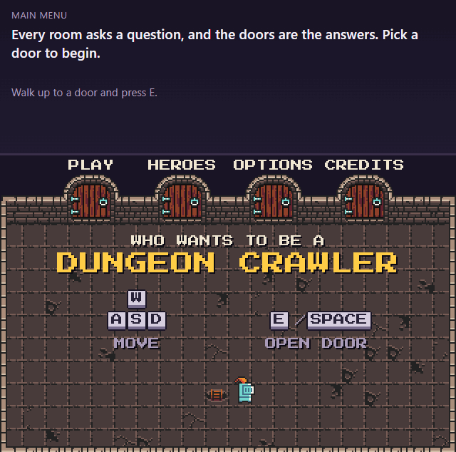

# Who Wants To Be A Dungeon Crawler

A pixel-art quiz dungeon crawler that runs in the browser. Every room asks a question, and the doors are the answers. Pick the right door and you drop one level deeper into the dungeon. Pick the wrong one and the floor gives way.



**[▶ Play it in your browser](https://dungeon-crawler.salihonder.dev)**

## How to play

| Key | Action |
|---|---|
| <kbd>W</kbd> <kbd>A</kbd> <kbd>S</kbd> <kbd>D</kbd> or arrow keys | Move |
| <kbd>E</kbd> or <kbd>Space</kbd> | Open a door, pull a lever, climb a ladder, pick a hero |

The menu is a room too: walk through **PLAY** to start, or explore **HEROES**, **OPTIONS** and **CREDITS**. In the dungeon, stand at the door with your answer and open it. Your score is how deep you get.

Touch controls aren't supported yet; it's best played with a keyboard.

## Features

- **Questions as doors:** each room shows a question with 2–4 answers, one door per answer, shuffled on every run.
- **Suspense:** right and wrong doors look the same until you land in the next room. A safe landing shows "Correct!"; a wrong one cracks the floor into a spike pit.
- **Learning from mistakes:** the game over card shows your answer, the correct one, and an explanation.
- **10 playable heroes:** pick one in the Heroes room, and it's remembered.
- **Options as levers:** sound, music and screen shake, all remembered between visits.
- **Sound and music made in code:** sound effects are generated with ZzFX, and the background music is a chiptune loop composed in code with the Web Audio API. There are no audio files.

## How it works

Plain JavaScript (ES modules) with the [Kaplay](https://kaplayjs.com) game engine. There's no build step: the browser loads `index.html` and the files in `src/` directly, and GitHub Pages hosts it.

A few parts worth a look:

- **One interaction system** ([`src/interact.js`](src/interact.js)): doors, levers, heroes and ladders all work the same way. Each is a zone, a prompt and a `use()` function, and one small module handles detecting the nearest one, the on-screen prompt and the key presses.
- **Cutscenes with `async`/`await`** ([`src/cutscenes.js`](src/cutscenes.js)): Kaplay's tweens and timers are wrapped in Promises, so sequences like "open the door, walk in, fade out" read top to bottom.
- **Layered drawing:** when the knight steps into a doorway, he's drawn behind the door frame but in front of the darkness behind it, using draw order (`z`), so he really walks *into* the door.
- **A stable layout** ([`src/panel.js`](src/panel.js)): the question panel above the game is locked to the height of the dungeon's tallest question, measured on an invisible copy of the panel, so the game never jumps in size during play.
- **Crisp pixels** ([`src/display.js`](src/display.js)): the game is drawn at 320×208 and scaled up by a whole number of real screen pixels (accounting for `devicePixelRatio`) when that keeps most of the space, so every pixel is the same size.
- **Safe user content:** question text is always inserted with `textContent`, never `innerHTML`, ready for user-made dungeons.
- **Procedural music** ([`src/music.js`](src/music.js)): notes are written as data (`"E5 . . D5 C5"`) and scheduled ahead of time on the Web Audio clock for precise timing.

## Project structure

```
index.html            the page: the question panel and the game area
style.css             panel and card styles
src/
  main.js             entry point: sets up Kaplay, loads everything, opens the title room
  config.js           shared sizes, speed and colors
  menu.js             the title room and the Heroes, Options and Credits rooms
  scenes.js           the question rooms
  cutscenes.js        falling in, walking through doors, the floor collapse, ladders
  interact.js         using doors, levers, heroes and ladders
  doors.js, room.js, props.js, player.js, heroes.js   building the rooms and characters
  panel.js            the HTML panel and the game over / victory cards
  dungeon.js          loading a dungeon and shuffling a run
  sound.js, music.js  sound effects and music
  settings.js         remembered settings (localStorage)
  display.js          whole-pixel scaling
  effects.js          fades, flashes, dust, screen shake
data/dungeons/        dungeon files (questions, answers, explanations)
assets/               the tileset, font, icons and preview images
lib/zzfx.js           ZzFX sound generator
```

### Dungeon files

A dungeon is a JSON file of rooms:

```json
{
  "title": "Math Test Dungeon",
  "rooms": [
    {
      "question": "What is 1/2 + 1/4?",
      "correct": "3/4",
      "wrong": ["2/6", "1/6", "2/4"],
      "explanation": "Turn 1/2 into 2/4 so both have the same bottom number. Then 2/4 + 1/4 = 3/4."
    }
  ]
}
```

## Running it locally

The game loads its files with `fetch`, so it needs to be served rather than opened as a file. Any static server works, for example:

```bash
python -m http.server 8000
```

Then open http://localhost:8000. In VS Code, the Live Server extension works too.

## Credits

- Game by [Salih Önder](https://salihonder.dev)
- Art: [16x16 DungeonTileset II](https://0x72.itch.io/dungeontileset-ii) by 0x72 (CC0)
- Font: [Press Start 2P](https://fonts.google.com/specimen/Press+Start+2P) by CodeMan38 (SIL Open Font License, see [`assets/fonts/OFL-LICENSE.txt`](assets/fonts/OFL-LICENSE.txt))
- Engine: [Kaplay](https://kaplayjs.com)
- Sound effects: [ZzFX](https://github.com/KilledByAPixel/ZzFX) by Frank Force (MIT, see [`lib/ZZFX-LICENSE.txt`](lib/ZZFX-LICENSE.txt))
- Built with Claude (Anthropic) as a pair programmer

## License

The game's code is released under the [MIT License](LICENSE). The third-party assets keep their own licenses: the tileset is CC0, the font is under the SIL Open Font License, and ZzFX is MIT (see Credits).
